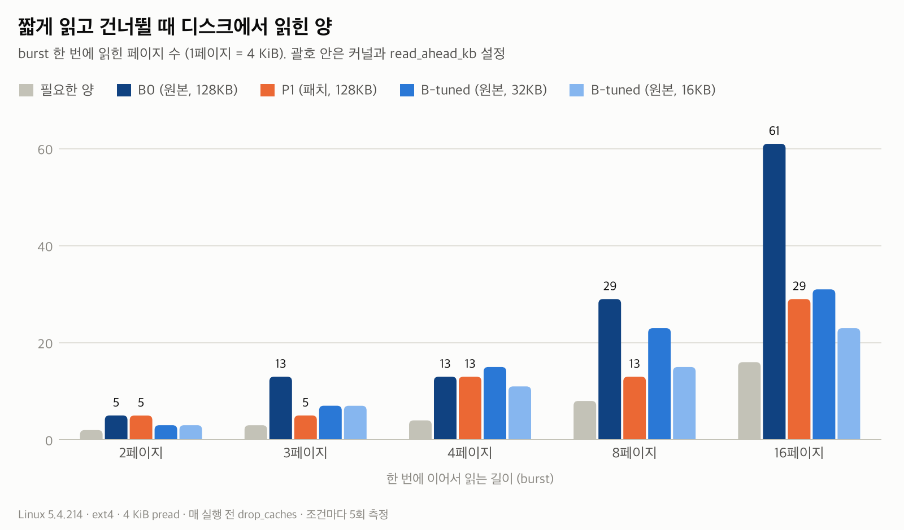
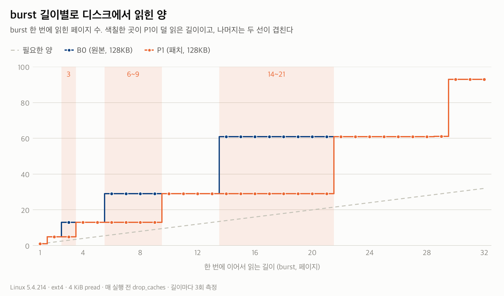
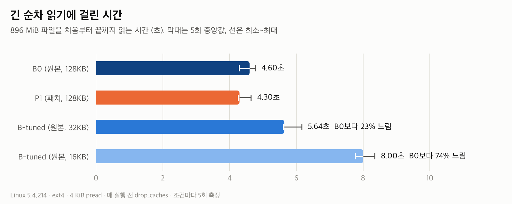
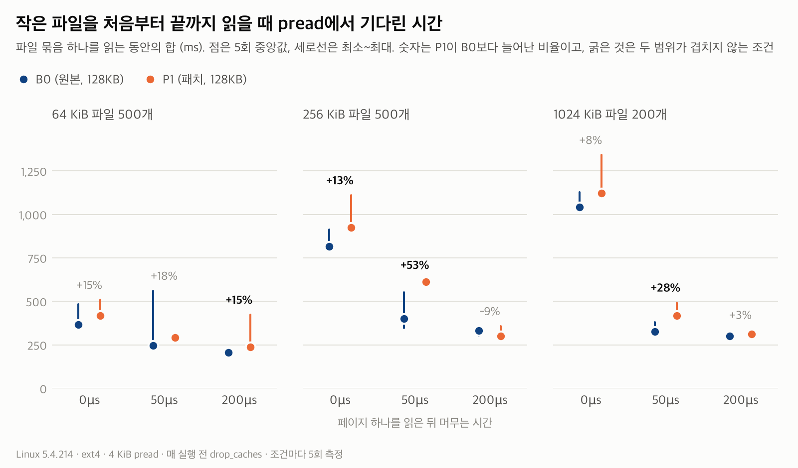

# ext4 환경에서 파일 readahead 정책 개선

중앙대 2026-2 리눅스 시스템 응용 설계 텀프로젝트 8팀 저장소.

리눅스는 파일을 읽으면 그다음 부분을 미리 읽어 둔다(readahead). 조금 읽고 멀리 건너뛰는 패턴에서는 미리 읽은 페이지가 쓰이지 않고 버려진다. 이 프로젝트는 Linux 5.4.214의 `mm/readahead.c`에 3줄을 더해 이 낭비를 줄이고, 원본 커널과 비교해 측정했다.

burst 길이 1~32페이지 중 13개에서 낭비가 절반 이하로 줄었고, 나머지는 원본과 같다. 대신 작은 파일을 처음부터 끝까지 읽을 때는 디스크를 기다리는 시간이 늘었다. 얻은 것과 잃은 것을 함께 적는다.

## 결과 요약

| 읽기 패턴 | P1(패치)의 결과 |
|---|---|
| 짧게 읽고 건너뛰기 | burst 길이 1~32페이지 중 13개(3, 6~9, 14~21페이지)에서 디스크에서 읽는 양이 원본의 절반 이하다. 나머지 19개는 같고, 더 많이 읽는 길이는 없다 |
| 긴 파일 순차 읽기 (896 MiB) | 차이가 없다 |
| 작은 파일 순차 읽기 (64 KiB~1 MiB) | `pread`에서 기다리는 시간이 9개 조건 중 8개에서 늘었다 (+3~53%) |

### 짧게 읽고 건너뛰기

burst 한 번에 디스크에서 읽힌 페이지 수다. 4 KiB씩 N페이지를 읽고 1 MiB를 건너뛰기를 500번 반복했다.

| burst 길이 | 필요한 양 | B0 (원본) | P1 (패치) | B-tuned 32KB | B-tuned 16KB |
|---|---|---|---|---|---|
| 2페이지 | 2 | 5 | 5 | 3 | 3 |
| 3페이지 | 3 | 13 | 5 | 7 | 7 |
| 4페이지 | 4 | 13 | 13 | 15 | 11 |
| 8페이지 | 8 | 29 | 13 | 23 | 15 |
| 16페이지 | 16 | 61 | 29 | 31 | 23 |

- 원본 커널은 짧은 burst에서 필요한 양의 2.5~4.3배를 읽는다.
- P1은 3·8·16페이지 burst에서 읽는 양이 원본의 절반 이하로 줄었고, 2·4페이지에서는 같다. 이 다섯 길이는 미리 정한 것이고, 모든 길이에서 어떤지는 아래에서 따로 쟀다.
- B-tuned는 원본 커널에서 `read_ahead_kb`만 줄인 설정이다. 짧은 burst의 낭비는 줄지만 아래처럼 긴 순차 읽기가 느려진다.



#### burst 길이 1~32페이지 전체

위 다섯 길이만으로는 P1이 얼마나 자주 이득인지 알 수 없어서, burst 길이를 1페이지부터 32페이지까지 하나씩 바꿔 가며 쟀다(길이마다 3회, 2026-11-16).



- P1이 덜 읽는 길이는 3, 6~9, 14~21페이지로 32개 중 13개다. 이 구간에서는 읽는 양이 원본의 절반 이하다(13→5, 29→13, 61→29).
- 나머지 19개 길이에서는 같다. P1이 더 많이 읽는 길이는 없다.
- 계단 모양인 이유는 다음 window를 시작하는 페이지가 정해져 있기 때문이다. burst 안에서 몇 번째 페이지를 읽을 때 다음 window가 시작되는지가 원본은 3, 6, 14, 30번째, P1은 4, 10, 22, 30번째다. 두 커널의 시작점 사이에 끝나는 burst만 P1이 덜 읽는다. 30번째부터는 window가 상한(32페이지)에 닿아서 두 커널이 같다.
- 읽은 양은 3회 반복에서 같았고, 커널 코드를 따라 계산한 값과 모든 길이에서 일치했다. 전체 수치는 [analysis/summary_sweep.csv](analysis/summary_sweep.csv)에 있다(B-tuned 포함).

burst 읽기 시간은 [analysis/fig2_burst_time.png](analysis/fig2_burst_time.png)에 있다. P1은 읽는 양이 준 3페이지와 8페이지에서 약 20% 빨랐지만, VM에서 조건마다 5회 잰 값이라 읽은 양을 주 결과로 보고 시간은 보조로 본다.

### 긴 파일 순차 읽기

896 MiB 파일을 처음부터 끝까지 읽는 시간(5회 중앙값)이다.

| 조건 | 시간 | B0 대비 |
|---|---|---|
| B0 (원본) | 4.60초 | 기준 |
| P1 (패치) | 4.30초 | 차이 없음 (최소~최대 범위가 겹침) |
| B-tuned 32KB | 5.64초 | 23% 느림 |
| B-tuned 16KB | 8.00초 | 74% 느림 |



P1은 window가 상한(32페이지)에 닿은 뒤에는 원본과 똑같이 동작한다. 상한에는 파일의 처음 28페이지(112 KiB) 안에서 닿으므로, 긴 파일에서는 차이가 드러나지 않는다.

### 작은 파일 순차 읽기

파일이 작으면 읽기의 대부분이 window가 작은 구간에서 일어난다. 그래서 작은 파일 여러 개를 하나씩 처음부터 끝까지 읽는 경우를 따로 쟀다. 실제 프로그램은 읽은 내용을 처리하느라 시간을 쓰므로, 페이지 하나를 읽을 때마다 0, 50, 200마이크로초 동안 머무는 조건을 두었다.

아래는 파일 묶음 하나를 읽는 동안 `pread` 안에서 보낸 시간의 합(ms)이다. 5회 중앙값이고 괄호 안은 최소~최대다. 굵은 줄은 B0와 P1의 범위가 겹치지 않는 조건이다.

| 파일 | 머무는 시간 | B0 (원본) | P1 (패치) | 차이 |
|---|---|---|---|---|
| 64 KiB × 500개 | 0 | 365 (363~485) | 419 (413~509) | +15% |
| | 50µs | 246 (242~562) | 292 (269~295) | +18% |
| | **200µs** | **207 (192~229)** | **239 (232~424)** | **+15%** |
| 256 KiB × 500개 | **0** | **817 (806~913)** | **924 (918~1111)** | **+13%** |
| | **50µs** | **401 (347~554)** | **612 (593~624)** | **+53%** |
| | 200µs | 332 (300~358) | 302 (291~358) | −9% |
| 1024 KiB × 200개 | 0 | 1042 (1041~1126) | 1123 (1100~1342) | +8% |
| | **50µs** | **327 (320~379)** | **419 (413~494)** | **+28%** |
| | 200µs | 302 (286~306) | 312 (298~337) | +3% |

- P1은 9개 조건 중 8개에서 더 오래 기다렸고, 그중 4개는 범위가 겹치지 않는다. 줄어든 한 조건(−9%)은 범위가 겹친다.
- 실행 전체 시간으로 보면 쉬지 않고 읽을 때 8~13% 느리다. 페이지마다 50µs 머물면 1~8%, 200µs 머물면 차이가 1% 안팎이다.
- 디스크에서 읽은 양과 체크섬은 B0와 P1이 같다. 달라진 것은 읽는 양이 아니라 기다리는 시간이다.



### 읽은 내용

읽은 내용은 모든 조건에서 같다. 파일 전체의 SHA-256과 패턴별 체크섬으로 확인했다.

전체 수치는 [analysis/summary.csv](analysis/summary.csv), [analysis/summary_sweep.csv](analysis/summary_sweep.csv), [analysis/summary_smallfile.csv](analysis/summary_smallfile.csv)에 있다.

## 무엇을 바꿨나

`ondemand_readahead()`가 `ra_submit()`을 부르기 바로 앞에 아래 3줄을 넣었다. 패치 파일은 [patches/p1-readahead-marker.patch](patches/p1-readahead-marker.patch)다.

```c
if (req_size == 1 && ra->size < max_pages)
	ra->async_size = min_t(unsigned int, ra->async_size,
			       max_t(unsigned int, 1, ra->size / 2));
```

커널은 미리 읽은 구간(window) 안의 한 페이지에 표시(marker)를 해 두고, 읽기가 그 페이지에 닿으면 다음 window를 미리 읽기 시작한다. 원본은 window의 앞쪽에 표시를 두기 때문에 3페이지만 읽어도 다음 window가 시작된다. 패치는 window가 상한(기본 32페이지)보다 작은 동안 표시를 window의 뒤쪽 절반에 둔다. window가 상한에 닿으면 원본과 똑같이 동작하므로 긴 순차 읽기는 그대로다.

### 왜 작은 파일 순차 읽기는 느려지나

원본이 표시를 앞쪽에 두는 데는 이유가 있다. 읽기가 표시에 일찍 닿으면 지금 window의 디스크 읽기가 끝나기 전에 다음 window를 요청하게 되어, 디스크 요청 두 개가 겹쳐서 진행된다. 프로그램이 다음 window에 도착했을 때는 데이터가 이미 와 있거나 곧 온다. 커널 주석은 이것을 "maximum pipelining"이라고 부른다.

P1은 표시를 뒤로 미뤘으므로 다음 window 요청이 그만큼 늦게 나간다. 건너뛰는 패턴에서는 쓰지 않을 요청이 나가지 않아 이득이지만, 계속 이어서 읽는 경우에는 데이터가 아직 오지 않아 기다리게 된다. 즉 P1은 버려지는 미리 읽기와 순차 읽기 초반의 대기 시간을 맞바꾼 것이다.

## 저장소 구조

| 폴더 | 내용 |
|---|---|
| `patches/` | P1 패치 |
| `bench/` | 벤치마크 `ra_bench`, `smallfile_bench` (C), Makefile |
| `scripts/` | 측정 스크립트 |
| `results/` | 원자료 CSV, 커널 설정 파일, [실행 환경 기록](results/environment.md) |
| `analysis/` | 그래프 스크립트, 그림, 요약표 |

커널 전체 소스는 올리지 않는다.

## 재현 방법

Ubuntu 20.04(x86_64, gcc 9.4.0) VM에서 했다. 커널 설치, 캐시 비우기, 디스크 마운트에 sudo가 필요하다.

### 1. 커널 두 개 빌드

소스는 git 저장소 바깥에 푼다. 안에 풀면 커널 이름 끝에 `+`가 붙는다.

```bash
wget https://cdn.kernel.org/pub/linux/kernel/v5.x/linux-5.4.214.tar.xz
tar -xJf linux-5.4.214.tar.xz
cd linux-5.4.214
```

B0(원본)를 빌드하고 설치한다. 커널 이름은 `5.4.214-b0`이 된다.

```bash
cp <저장소>/results/config-5.4.214-b0 .config
make olddefconfig
make -j"$(nproc)"
sudo make modules_install INSTALL_MOD_STRIP=1
sudo make install
```

같은 폴더에 패치를 적용해 P1을 빌드하고 설치한다. 커널 이름은 `5.4.214-p1`이 된다.

```bash
patch -p1 < <저장소>/patches/p1-readahead-marker.patch
scripts/config --set-str LOCALVERSION "-p1"
make -j"$(nproc)"
sudo make modules_install INSTALL_MOD_STRIP=1
sudo make install
```

`config-5.4.214-b0`은 우리 VM에서 쓰는 모듈만 남긴 설정이라 다른 컴퓨터에서는 부팅되지 않을 수 있다. 그럴 때는 자기 환경의 설정에서 `make localmodconfig`로 만들고 `CONFIG_LOCALVERSION`만 `-b0`으로 바꾼다.

### 2. 새 커널로 한 번만 부팅

기본 부팅 항목은 그대로 두고 다음 부팅 한 번만 새 커널을 쓴다. 부팅에 실패해도 다시 켜면 원래 커널로 돌아온다.

```bash
grep -E "menuentry |submenu " /boot/grub/grub.cfg    # 항목 ID 확인
sudo grub-reboot "<Advanced options 항목 ID>><5.4.214-b0 항목 ID>"
sudo reboot
```

### 3. 측정

테스트 파일은 ext4 위에 있는 600 MiB 이상의 일반 파일이면 된다. 우리는 수업 과제 8에서 fio가 만든 896 MiB 파일을 읽기 전용으로 마운트해서 썼다. 디스크와 파일 경로는 `scripts/measure_kernel.sh` 위쪽의 `DEV`, `MNT`, `FILE`에서 바꾼다.

아래 명령은 저장소 최상위 폴더에서 실행한다.

```bash
make -C bench
scripts/measure_kernel.sh B0    # 5.4.214-b0으로 부팅한 상태에서. B-tuned(32, 16)도 이어서 잰다
scripts/measure_kernel.sh P1    # 5.4.214-p1으로 부팅한 상태에서
```

결과는 `results/compare_<조건>_<커널>.csv`로 저장된다. 스크립트는 부팅 후 4분이 지나고 부하가 가라앉을 때까지 기다렸다가 시작하고, 매 실행 전에 `drop_caches`를 한다.

burst 길이 1~32페이지 전체는 따로 잰다. 결과는 `results/sweep_<커널>.csv`로 저장된다.

```bash
scripts/measure_sweep.sh B0    # 5.4.214-b0으로 부팅한 상태에서. B-tuned(32, 16)도 이어서 잰다
scripts/measure_sweep.sh P1    # 5.4.214-p1으로 부팅한 상태에서
```

패턴 하나만 따로 돌려 볼 수도 있다.

```bash
bench/ra_bench -H                              # CSV 머리글
bench/ra_bench -f <파일> -p burst -b 3 -n 500   # 3페이지씩 500번
bench/ra_bench -f <파일> -p seq                 # 처음부터 끝까지
```

### 4. 작은 파일 순차 읽기 측정

파일 1,200개(약 360 MiB)를 ext4 위의 폴더에 한 번 만들어 두고, 커널마다 부팅해서 잰다.

```bash
scripts/make_small_files.sh <폴더>
scripts/measure_smallfiles.sh B0 <폴더>    # 5.4.214-b0으로 부팅한 상태에서
scripts/measure_smallfiles.sh P1 <폴더>    # 5.4.214-p1으로 부팅한 상태에서
```

결과는 `results/smallfile_<조건>_<커널>.csv`로 저장된다.

### 5. 그래프

```bash
pip install matplotlib
python3 analysis/plot_results.py
```

## 실험 환경과 한계

VM 사양, 커널 빌드 방법, 테스트 디스크, 측정 기록은 [results/environment.md](results/environment.md)에 있다.

- VirtualBox VM 한 대에서 잰 결과다. burst와 긴 순차 읽기는 가상 디스크 하나의 파일 하나로, 작은 파일 순차 읽기는 루트 디스크에 만든 파일들로 쟀다.
- B0와 P1은 서로 다른 부팅에서 5회씩 쟀다. 시간 차이는 반복 간 편차와 함께 봐야 한다.
- 읽은 양은 커널 코드로 계산한 값과 일치하고 반복해도 같다.
- 단일 프로세스의 4 KiB `pread`만 쟀다. 여러 프로세스가 같이 읽는 경우나 `mmap`은 보지 않았다.
- 건너뛰는 읽기와 작은 파일 순차 읽기 중 어느 쪽이 실제로 더 흔한지는 재지 않았다. 그래서 P1이 전체적으로 이득인지는 말할 수 없다.
